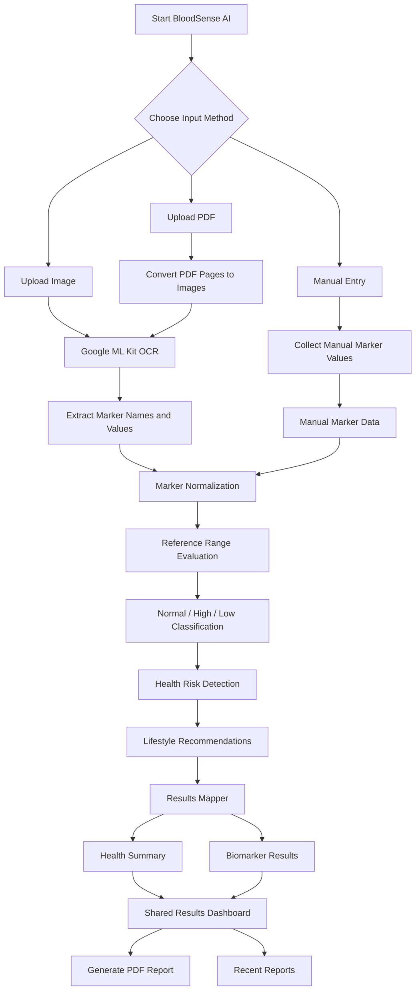

# 🩸 BloodSense AI – Blood Report Analysis

**BloodSense AI** is an intelligent blood report analysis feature built with Flutter. It extracts biomarker values from blood report images and PDF documents, compares the extracted values against predefined clinical reference ranges, identifies abnormal markers, detects potential health-risk patterns, and provides personalized lifestyle recommendations.

The feature also supports manual blood report entry, allowing users to enter their test results without uploading a document.

---

## 📌 Table of Contents

- [Overview](#-overview)
- [Key Features](#-key-features)
- [Supported Input Methods](#-supported-input-methods)
- [System Workflow](#-system-workflow)
- [1. Image-Based Blood Report Extraction](#1-image-based-blood-report-extraction)
- [2. PDF-Based Blood Report Extraction](#2-pdf-based-blood-report-extraction)
- [3. Manual Blood Report Entry](#3-manual-blood-report-entry)
- [Blood Marker Normalization](#-blood-marker-normalization)
- [Reference Range Evaluation](#-reference-range-evaluation)
- [Health Risk Detection](#-health-risk-detection)
- [Lifestyle Recommendations](#-lifestyle-recommendations)
- [Results Dashboard](#-results-dashboard)
- [PDF Report Generation](#-pdf-report-generation)
- [Recent Reports and Temporary Storage](#-recent-reports-and-temporary-storage)
- [Technology Stack](#-technology-stack)
- [Project Structure](#-project-structure)
- [CSV Dataset Structure](#-csv-dataset-structure)
- [Installation and Setup](#-installation-and-setup)
- [Important Implementation Details](#-important-implementation-details)
- [Limitations](#-limitations)
- [Medical Disclaimer](#-medical-disclaimer)
- [Future Improvements](#-future-improvements)

---

## 🔍 Overview

BloodSense AI simplifies the process of understanding blood test reports.

Traditional blood reports contain several laboratory parameters, numerical values, measurement units, and reference intervals. Understanding these values can be difficult for users without medical knowledge.

BloodSense AI processes blood report information through a multi-stage pipeline:

1. Extracts text and biomarker values from uploaded reports using OCR.
2. Identifies and standardizes biomarker names.
3. Extracts numerical test values.
4. Compares values against predefined reference ranges.
5. Classifies markers as Normal, High, or Low.
6. Detects combinations of abnormal markers associated with potential health-risk patterns.
7. Provides lifestyle recommendations for abnormal markers.
8. Generates a structured results dashboard and downloadable PDF report.

The application uses a shared analysis engine for image uploads, PDF uploads, and manual entry.

---

## ✨ Key Features

- **Image Upload:** Upload blood report images in supported image formats.
- **PDF Upload:** Extract information from multi-page PDF blood reports.
- **Manual Entry:** Enter patient details and blood marker values manually.
- **OCR-Based Extraction:** Extract laboratory text using Google ML Kit Text Recognition.
- **Marker Recognition:** Match different laboratory naming conventions using a synonym dataset.
- **Reference Range Comparison:** Evaluate biomarker values against stored reference intervals.
- **Gender-Based Evaluation:** Use gender-specific reference ranges where available.
- **Abnormal Marker Detection:** Identify high and low biomarker values.
- **Health-Risk Pattern Detection:** Identify combinations of abnormal markers using predefined rules.
- **Lifestyle Recommendations:** Display foods to add, foods to avoid, and exercise suggestions.
- **Detailed Biomarker View:** Show individual biomarker results and their interpretations.
- **Health Summary:** Present an overall summary of evaluated markers.
- **PDF Report Generation:** Generate a downloadable report containing analysis results.
- **Recent Reports:** Save and retrieve temporary reports locally.
- **Shared Results Dashboard:** Display results consistently regardless of the input method.

---

## 📥 Supported Input Methods

BloodSense AI supports three ways to provide blood report information.

| Input Method | Description | Processing |
|---|---|---|
| Image Upload | Upload a photograph or scanned image of a blood report | OCR extraction |
| PDF Upload | Upload a laboratory PDF report | PDF page conversion followed by OCR |
| Manual Entry | Select markers and enter their values | Direct numerical processing |

All three input methods ultimately use the same BloodSense evaluation and results-mapping logic.

---

## 🔄 System Workflow



---

## 1. Image-Based Blood Report Extraction

BloodSense AI supports image-based blood report analysis using Google ML Kit Text Recognition.

### Processing Steps

1. The user selects a blood report image from the gallery or captures a photograph.
2. The selected image is passed to the OCR extraction module.
3. Google ML Kit recognizes text within the image.
4. Extracted text lines are processed to identify biomarker names and numerical values.
5. Text lines are grouped into rows using their vertical bounding-box positions.
6. The extracted marker names are normalized.
7. Numerical values are passed to the evaluation engine.

### OCR Processing

The extraction process includes:

- Text recognition from report images.
- Grouping text lines into rows based on vertical positions.
- Removing unnecessary characters.
- Cleaning numerical values.
- Detecting gender information from recognized text.
- Extracting the first relevant numerical value from a marker row.
- Handling absolute blood cell counts.

### Numerical Value Cleaning

The OCR processing handles common formatting issues, including:

- Thousands separators.
- Spaces within numerical values.
- Comma and decimal formatting.
- Scientific-style count representations such as `10^3`.
- Absolute cell count markers.

Absolute count markers are identified using the `_absolute` suffix where applicable.

### Gender Detection

The OCR extraction module attempts to identify gender from report text.

It recognizes common text variations such as:

- Female-related terms and prefixes.
- Male-related terms and prefixes.

If gender cannot be identified, the existing extraction flow uses its configured default gender.

---

## 2. PDF-Based Blood Report Extraction

PDF reports are processed by converting their pages into images before running OCR.

### Processing Steps

1. The user selects a PDF blood report.
2. The PDF handler loads the selected document.
3. Each PDF page is rendered as an image.
4. Pages are rendered at an increased resolution to support OCR accuracy.
5. Generated page images are passed to the image extraction pipeline.
6. Extracted biomarker values are evaluated using the shared BloodSense engine.

### PDF Processing Technology

The implementation uses:

- `file_picker` for selecting PDF files.
- `pdfx` for rendering PDF pages.
- Temporary image files for OCR processing.
- Google ML Kit Text Recognition for text extraction.

### Multi-Page Support

The PDF processing pipeline supports reports containing multiple pages.

Each page is converted into an image, and the extracted marker data is combined before reference-range evaluation.

---

## 3. Manual Blood Report Entry

BloodSense AI also supports manual blood report entry.

This is useful when:

- The report image is unclear.
- OCR cannot recognize certain markers.
- The user wants to enter laboratory values directly.
- A digital report is unavailable.

### Manual Entry Workflow

The manual entry interface follows a three-step process.

**Step 1 – Patient Details**

The user enters:

- Full name.
- Age.
- Gender.
- Report date.

**Step 2 – Select Blood Markers**

The user selects the markers available in the report.

Markers are organized into categories such as:

- Haematology.
- Biochemistry.
- Lipid Profile.
- Others.

The interface also supports marker search.

**Step 3 – Enter Test Values**

The user enters numerical values for the selected markers.

The application validates the entered values before starting analysis.

### Manual Processing

Manual values are converted into a marker-value map and passed to the same processing function used by the BloodSense evaluation engine.

This ensures that manually entered values are evaluated using the same reference-range and risk-detection logic as OCR-extracted values.

---

## 🔤 Blood Marker Normalization

Laboratory reports often use different names and abbreviations for the same biomarker.

For example:

| Laboratory Name | Standard Marker |
|---|---|
| Hb | Hemoglobin |
| Hgb | Hemoglobin |
| A1c | HbA1c |
| FBS | Glucose Fasting |
| PLT | Platelet Count |
| Erythrocyte Count | RBC |

BloodSense AI uses a marker synonym dataset to standardize these variations.

### Normalization Process

1. The extracted or manually entered marker name is received.
2. The name is converted into a standardized format.
3. Special characters and unnecessary spaces are removed for matching.
4. The synonym dataset is searched.
5. The corresponding standard marker name is returned.
6. The standardized marker is passed to the evaluation engine.

### Main File

`normalizer.dart`

The normalization module contains:

- `buildSynonymMap()`
- `normalizeMarker()`

This makes marker matching more consistent across different laboratory report formats.

---

## 📊 Reference Range Evaluation

After marker normalization, BloodSense AI compares each numerical result against the reference ranges stored in the clinical dataset.

### Reference Range Dataset

`assets/blood_report/reference_ranges.csv`

The dataset contains biomarker information and corresponding reference boundaries.

The evaluation engine uses:

- Marker name.
- Measured value.
- Gender.
- Lower reference boundary.
- Upper reference boundary.

### Evaluation Logic

For markers with lower and upper boundaries:

| Condition | Classification |
|---|---|
| Value below lower boundary | Low |
| Value within reference boundaries | Normal |
| Value above upper boundary | High |

Some biomarkers use one-sided reference limits, depending on how the reference data is defined.

### Gender-Specific Reference Ranges

Where available, the evaluator uses separate reference intervals for male and female patients.

This is important because certain blood parameters have different reference intervals depending on gender.

### Main File

`evaluator.dart`

The evaluation function:

`evaluateMarker()`

compares the marker value with the corresponding reference row and returns its evaluation status.

---

## ⚠️ Health Risk Detection

BloodSense AI includes a rule-based health-risk detection engine.

Instead of evaluating each abnormal marker in isolation, the engine can identify combinations of abnormal markers associated with predefined health-risk patterns.

### Examples of Evaluated Patterns

The existing rules include patterns related to:

- Metabolic health.
- Cardiovascular health.
- Kidney function.
- Liver function.
- Thyroid function.
- Anaemia-related patterns.
- Gout-related patterns.
- Vitamin deficiencies.

### How It Works

1. Evaluated marker results are received.
2. Marker statuses are checked.
3. High and low markers are identified.
4. Related markers are grouped according to predefined rules.
5. Matching risk patterns are returned.
6. Associated reasons and lifestyle information are included where available.

### Main File

`risk_engine.dart`

Main function:

`detectHealthRisks()`

The engine uses predefined conditions and marker combinations. It is a rule-based system, not a machine-learning diagnostic model.

---

## 🥗 Lifestyle Recommendations

BloodSense AI provides lifestyle recommendations for abnormal biomarkers using a structured CSV dataset.

### Dataset

`assets/blood_report/lifestyle.csv`

The dataset contains marker-specific recommendations for high and low results.

### Recommendation Categories

**Foods to Add**

Food suggestions associated with the selected abnormal marker.

**Foods to Avoid**

Food items that may be advisable to limit based on the marker's evaluation.

**Recommended Exercise**

Exercise suggestions associated with the marker.

**Exercise to Avoid**

Activities that may need caution depending on the recommendation data.

**Lifestyle Focus**

Additional lifestyle guidance associated with the marker.

### Recommendation Matching

The application matches evaluated biomarker names with the lifestyle dataset.

The marker synonym mapping helps account for naming differences between laboratory reports and recommendation records.

Recommendations are displayed only when matching data is available.

---

## 📱 Results Dashboard

After analysis, the application displays the processed results through a shared Results Page.

The same results interface is used for image uploads, PDF uploads, and manual entry.

### Results Include

- Overall health summary.
- Total evaluated markers.
- Normal marker count.
- High marker count.
- Low marker count.
- Biomarker result cards.
- Marker status indicators.
- Health-risk patterns.
- Lifestyle recommendations.

### Detailed Biomarker View

Users can select an individual biomarker to view more information.

The detailed page includes:

- Result overview.
- Measured value.
- Reference range.
- Severity or status.
- Clinical interpretation.
- Related health-risk patterns.
- Foods to add and avoid.
- Exercise recommendations.
- Lifestyle focus.
- Health guidance.
- Medical disclaimer.

The detailed recommendations are based on the marker's evaluation and the available lifestyle dataset.

---

## 📄 PDF Report Generation

BloodSense AI can generate a structured PDF report containing the evaluated results.

### PDF Report Contents

- Biomarker names.
- Measured values.
- Measurement units.
- Reference ranges.
- Evaluation status.
- Health summary information.

The PDF generation module uses the processed results from the shared results models.

### Main File

`blood_report_pdf_service.dart`

The generated report is available for the user's report workflow and can be saved with the corresponding temporary report record.

---

## 🗂 Recent Reports and Temporary Storage

BloodSense AI includes a Recent Reports feature for accessing previously analyzed reports.

### Temporary Storage

The report storage implementation uses:

- `TemporaryBloodReport`
- `TemporaryReportStorageService`
- AES-GCM encryption.
- Flutter Secure Storage.

### Stored Information

A temporary report record can contain:

- Report ID.
- Input type.
- Display name.
- Biomarker parameters.
- Health summary.
- Report generation date.
- Expiry date.
- Original document path, when applicable.
- Generated PDF path.

### Supported Report Types

- Image-based reports.
- PDF-based reports.
- Manually entered reports.

### Report Expiry

Reports are configured with a temporary retention period of **24 hours**.

The storage service manages the temporary report records and their retrieval.

**Important:** This implementation uses local encrypted temporary storage. It does not mean that the original blood report or generated PDF is automatically uploaded to Firebase.

---

## 🛠 Technology Stack

| Technology | Purpose |
|---|---|
| Flutter | Cross-platform application development |
| Dart | Application programming language |
| Google ML Kit Text Recognition | OCR-based text extraction |
| `image_picker` | Selecting or capturing report images |
| `file_picker` | Selecting PDF documents |
| `pdfx` | Converting PDF pages into images |
| CSV datasets | Reference ranges, synonyms, lifestyle recommendations |
| Flutter Secure Storage | Secure local key storage |
| AES-GCM | Encryption of temporary report storage |
| `path_provider` | Accessing application directories |
| `uuid` | Generating unique report identifiers |
| Firebase | Backend services used by the wider application |

---

## 📁 Project Structure

The following shows the main BloodSense-related files.

```text
lib/
│
├── core/
│   └── Report_Core/
│       ├── pdf_extractor.dart
│       ├── pdf_handler.dart
│       ├── report_processor.dart
│       ├── evaluator.dart
│       ├── normalizer.dart
│       └── risk_engine.dart
│
└── features/
    └── reports/
        │
        ├── data/
        │   ├── models/
        │   │   └── temporary_blood_report.dart
        │   │
        │   └── services/
        │       └── temporary_report_storage.dart
        │
        └── presentation/
            └── pages/
                │
                ├── Upload_image_page/
                │
                ├── Upload_pdf_page/
                │
                ├── Manual_entry_page/
                │
                ├── results/
                │   ├── results_page.dart
                │   ├── bloodsense_result_mapper.dart
                │   │
                │   └── widgets/
                │       ├── results_models.dart
                │       ├── blood_report_pdf_service.dart
                │       ├── parameter_result_card.dart
                │       └── ...
                │
                └── widgets/
                    └── analysing_report_popup.dart

assets/
└── blood_report/
    ├── reference_ranges.csv
    ├── marker_synonyms.csv
    └── lifestyle.csv
```

*Note: This is the main feature structure; individual widget filenames and folders may vary with the current application version.*

---

## 📑 CSV Dataset Structure

BloodSense AI relies on three primary CSV datasets.

### 1. `reference_ranges.csv`

Contains the reference intervals used to evaluate biomarker values.

Typical fields include:

| Field | Description |
|---|---|
| Marker | Standard biomarker identifier |
| Male_Low | Male lower reference boundary |
| Male_High | Male upper reference boundary |
| Female_Low | Female lower reference boundary |
| Female_High | Female upper reference boundary |

The exact columns depend on the configured reference dataset.

### 2. `marker_synonyms.csv`

Contains standardized marker names and their alternative laboratory names.

| Column | Description |
|---|---|
| Standard_Name | Standard biomarker identifier |
| Synonym | Alternative marker name or abbreviation |

### 3. `lifestyle.csv`

Contains lifestyle recommendations for abnormal biomarkers.

The dataset includes:

- Marker.
- Status.
- Foods to add.
- Foods to avoid.
- Recommended exercise.
- Exercise to avoid.
- Lifestyle focus.

Recommendation lists use semicolon-separated values where configured.

---

## 🚀 Installation and Setup

### Prerequisites

Make sure you have:

- Flutter SDK installed.
- Dart SDK configured.
- Android Studio or Visual Studio Code.
- A configured Android or iOS development environment.
- A Flutter project with the required dependencies.

### Step 1: Clone the Repository

```bash
git clone https://github.com/YOUR_USERNAME/YOUR_REPOSITORY.git
```

### Step 2: Open the Project

```bash
cd YOUR_REPOSITORY
```

### Step 3: Install Dependencies

```bash
flutter pub get
```

### Step 4: Configure CSV Assets

Make sure the BloodSense CSV datasets are present in:

```text
assets/blood_report/
```

Register the asset directory in `pubspec.yaml`:

```yaml
flutter:
  assets:
    - assets/blood_report/
```

### Step 5: Configure Required Packages

Ensure the project includes the dependencies used by the implementation, including the required packages for:

- Google ML Kit text recognition.
- Image selection.
- PDF selection and rendering.
- PDF generation.
- Secure local storage.
- File paths.
- Unique IDs.

Use the package versions compatible with your Flutter SDK and existing project.

### Step 6: Run the Application

```bash
flutter run
```

---

## ⚙ Important Implementation Details

### Shared Analysis Engine

Image, PDF, and manual entry flows use a shared evaluation pipeline.

This avoids maintaining three separate implementations for biomarker evaluation.

### Marker Standardization

The synonym dataset helps the application recognize different laboratory naming conventions.

For example, `Hb`, `Hgb`, and `Hemoglobin` can be mapped to the same standardized marker.

### Clinical Reference Data

The reference range dataset is the source used by the evaluator.

The marker catalog shown in the manual entry interface is for selection and display; it should not replace the evaluation dataset.

### Rule-Based Risk Detection

Health-risk patterns are determined by predefined rules in the risk engine.

The application does not independently diagnose diseases.

### Shared Results Mapping

The results mapper converts evaluated marker data into the UI's `ParameterResult` models and creates the overall health summary.

### Temporary Report Storage

Recent Reports uses encrypted local temporary storage with a configured 24-hour expiry period.

---

## ⚠ Limitations

- OCR accuracy depends on image quality, text clarity, report layout, and laboratory formatting.
- Complex tables and unusual report layouts may require manual correction.
- Different laboratories may use different units and reference intervals.
- Incorrect marker normalization can affect evaluation and recommendation matching.
- The current rule-based risk engine only detects patterns covered by its predefined rules.
- Lifestyle recommendations depend on the information available in the CSV dataset.
- Missing or unsupported reference ranges can prevent a marker from being evaluated.
- The temporary report storage implementation is local and does not automatically provide cloud synchronization.
- Age and other patient details should not be assumed to modify reference ranges unless the evaluator explicitly implements that functionality.

---

## 🩺 Medical Disclaimer

BloodSense AI is designed to help users understand the numerical information in their laboratory reports.

It is an informational tool and **not a substitute for professional medical advice, diagnosis, or treatment**.

The accuracy of its results depends on:

- Correct text extraction.
- Correct biomarker identification.
- Correct numerical values.
- Appropriate measurement units.
- The accuracy and applicability of the configured reference intervals.
- Relevant patient information.

Reference intervals can vary between laboratories and individuals.

Health-risk patterns and lifestyle suggestions are informational and should not be interpreted as confirmed medical diagnoses.

Users should consult a qualified healthcare professional before making medical or treatment decisions based on blood report results.

---

## 🔮 Future Improvements

Potential improvements include:

- Improved OCR handling for complex laboratory tables.
- Better support for different report layouts.
- Unit conversion and validation.
- Age-specific reference intervals where supported by clinical data.
- Expanded biomarker synonym datasets.
- More comprehensive recommendation datasets.
- Improved handling of missing and unsupported markers.
- Cloud-based report backup and synchronization.
- Long-term blood marker history and trend visualization.
- Improved report comparison between different dates.
- More comprehensive patient report management.

---

## 👨‍💻 Project Information

**Project:** BloodSense AI – Blood Report Analysis  
**Platform:** Flutter  
**Language:** Dart  
**Processing:** OCR + Rule-Based Evaluation  
**Data Sources:** CSV-based reference ranges, marker synonyms, and lifestyle recommendations  
**Storage:** Encrypted local temporary report storage

---

⭐ If you find this project useful, consider giving the repository a star!

